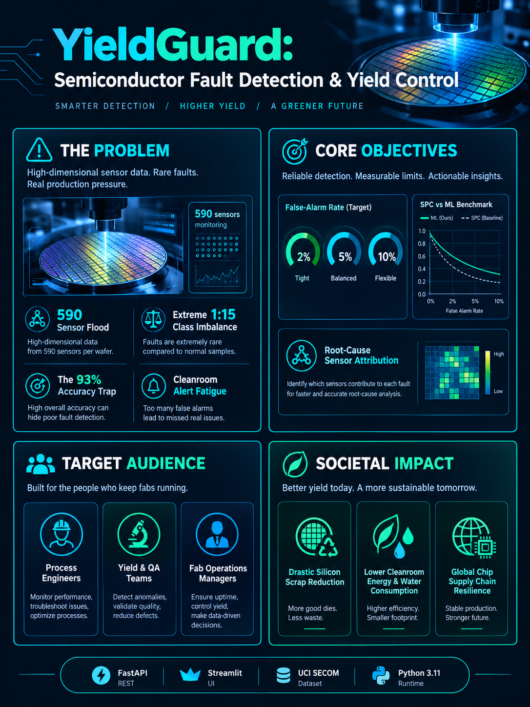
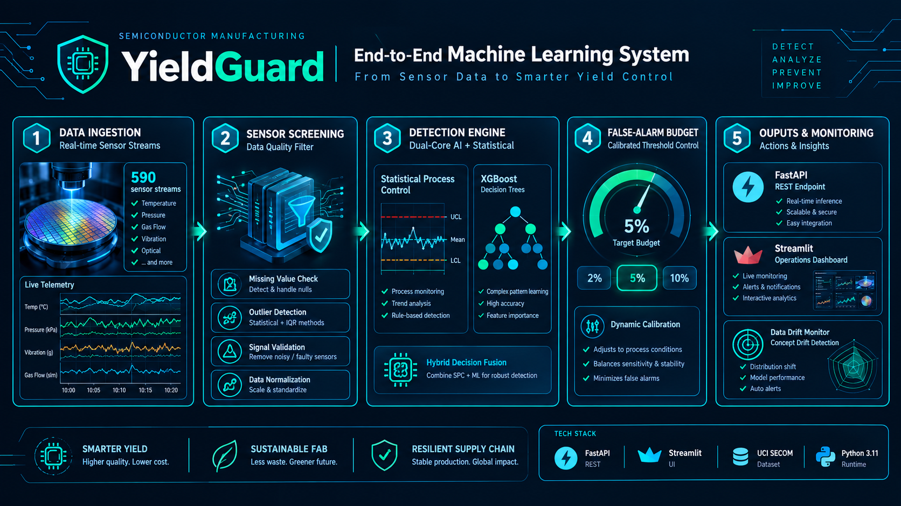
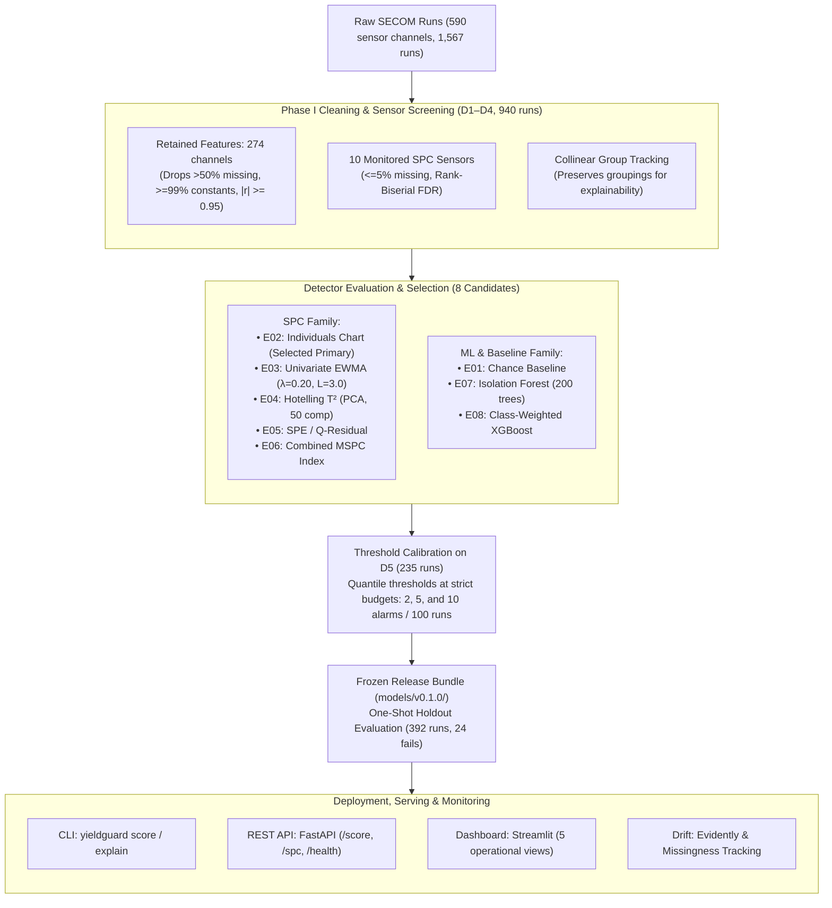

# YieldGuard

**Semiconductor process control, early fault detection, and sensor attribution under bounded false alarm budgets.**

[](LICENSE)
[](pyproject.toml)
[](api/main.py)
[](app/dashboard.py)
[](tests/)

<p align="center">
  
</p>

YieldGuard is an industrial decision-support and early fault detection platform built on the UCI SECOM semiconductor manufacturing dataset (590 sensor channels, 1,567 runs) and the Semiconductor Wafer Etch benchmark (7,164 runs). It bridges classical univariate Statistical Process Control (Shewhart Individuals, EWMA), multivariate MSPC (Hotelling $T^2$ and $SPE$ Q-residuals), and modern Machine Learning (Isolation Forest, class-weighted XGBoost) under strict operational false-alarm budgets (2, 5, or 10 alarms per 100 runs).

---

## 1. Problem, Objectives & Societal Impact

### 1.1 Problem Statement
* **High-Dimensional Sensor Flood:** Each wafer run records 590 continuous sensor channels, but only ~1 in 15 runs fails (~6.12% holdout prevalence), creating extreme class imbalance.
* **The "Accuracy" Paradox:** A naive baseline predicting "pass" for every run achieves ~93.9% accuracy while detecting zero defective wafers.
* **Alert Fatigue & Capacity Constraints:** Fab review capacity is strictly bounded—cleanroom engineers can typically review only 2 to 5 suspect wafers per 100 runs without stalling production.
* **Root-Cause Attribution Void:** Flagging runs without identifying *which* specific sensors drifted leads to lengthy fab investigations and prolonged equipment downtime.

### 1.2 Core Objectives
* **Bounded False-Alarm Detection:** Prioritize and rank failing wafer runs ahead of passing runs under strict, predeclared false-alarm budgets (2, 5, and 10 alarms per 100 runs).
* **Transparent SPC vs. ML Benchmarking:** Compare classical Statistical Process Control with modern machine learning on leak-free chronological splits without synthetic data inflation.
* **Actionable Root-Cause Attribution:** Automatically isolate and rank top anomaly-driving sensors for every flagged run via MSPC contributions and TreeSHAP waterfall values.
* **Production Engineering Delivery:** Provide low-latency scoring via a FastAPI REST service (p95 < 100 ms), a modular CLI, and an interactive Streamlit engineering console.

### 1.3 Target Audience
* **Process Engineers:** Live univariate EWMA charts, Phase I control limits ($\mu_0, \sigma_0$), and Western Electric rule violation markers.
* **Yield & Quality Engineers:** Bounded-budget triage queues with ranked sensor root-cause attribution.
* **Fab Operations Managers:** Stable false-alarm rates to prevent cleanroom alert fatigue and scrap containment bottlenecks.
* **MLOps & Industrial AI Practitioners:** Drift-adaptive rolling evaluation (Protocol `v0.2.0`), prequential benchmarking, and audit-ready model bundles.

### 1.4 Societal & Environmental Impact
* **Silicon Scrap & E-Waste Reduction:** Early wafer anomaly detection prevents defective silicon from progressing through costly chemical-mechanical polishing and packaging, drastically cutting semiconductor waste.
* **Cleanroom Resource Conservation:** Halting bad wafers early saves gigawatt-hours of electricity and millions of gallons of ultrapure water used in cleanroom lithography and etching.
* **Global Supply Chain Resilience:** Higher production yields reduce semiconductor shortages, stabilizing global supply for automotive, healthcare, and green-energy infrastructure.

---

## 2. System Architecture & Workflow

<p align="center">
  
</p>



---

## 3. Measured Empirical Results (`v0.1.0`)

> [!IMPORTANT]
> **Headline Verdict (`v0.1.0` on UCI SECOM Holdout): No detector beat chance.**
> Across the unseen chronological holdout set (**392 runs, 24 fails, prevalence 6.12%**), neither the primary SPC detector (`E02`, PR-AUC **0.0724**) nor the best ML detector (`E08` XGBoost, PR-AUC **0.0877**) achieved a 95% confidence interval excluding the 0.0612 chance baseline. Although `E02` satisfied the **O3** alarm-rate stability band (**3.06 alarms per 100 runs**, 12 total alarms), **0 of those 12 alarms were true failures (0 TP, 12 FP)**. Post-freeze drift analysis (`reports/drift/drift_summary.json`) showed significant distribution shift in **237 of 274 retained sensors (86.5%)** between the training blocks (`D1`–`D4`) and the holdout period.

All measurements below are recorded on the **unseen chronological holdout set** (392 runs, 24 fails, prevalence 6.12%). Evaluations were executed once post-freeze; predictions were written and hashed before opening holdout labels (`reports/holdout_predictions.csv`).

### 3.1 Predeclared Objective Verdicts (`O1`–`O7`)

| Target ID | Description | Predeclared Criterion | Measured Holdout Result | 95% Wider Bootstrap CI | Fail Count | Target Status | Evidence Link |
|---|---|---|---|---|---|---|---|
| **O1** | Fault Ranking PR-AUC | $\ge 2\times \text{prevalence} = 0.1224$ | **0.0724** (chance: 0.0612) | $[0.0384, 0.1514]$ | 24 | **MISS** | [holdout_metrics.json](reports/holdout_metrics.json) |
| **O2** | Operational Recall @ 5 FAR | $\ge 0.20$ (chance: 0.05) | **0.0417** (1 / 24 fails) | $[0.0000, 0.1765]$ | 24 | **MISS** | [holdout_metrics.json](reports/holdout_metrics.json) |
| **O3** | Alarm Budget Stability | Realised alarms $\in [2.0, 8.0]$ per 100 | **3.06 per 100** (12 alarms: **0 TP, 12 FP**) | N/A | 24 | **PASS (0 TP)** | [holdout_metrics.json](reports/holdout_metrics.json) |
| **O4** | SPC vs ML Comparison | Report paired diff & 95% CI | **+0.0153** (E08 vs E02) | $[-0.0470, +0.0910]$ | 24 | **REPORTED** | [holdout_metrics.json](reports/holdout_metrics.json) |
| **O5** | Sensor Attribution Ranking | 5-$\sigma$ injected fault in top-3 $\ge 90\%$ | **100.0%** (100 / 100 trials) | N/A | N/A | **PASS** | [o5_verification.json](reports/explanations/o5_synthetic_verification.json) |
| **O6** | Score Reproducibility | Multi-run score delta $\le 10^{-6}$ | **0.0** (exact match) | N/A | N/A | **PASS** | [runtime.json](reports/runtime.json) |
| **O7** | Engineering & API Delivery | CLI/API parity $\le 10^{-9}$; p95 latency | Parity: **0.0**; p95: **63.8 ms** | N/A | N/A | **PASS** | [runtime.json](reports/runtime.json) |

### 3.2 All Eight Detectors on the Chronological Holdout (392 Runs, 24 Fails, Prevalence 0.0612)

| Detector | Family | Holdout PR-AUC | 95% Wider PR-AUC CI | Recall @ 5 FAR | Budget-5 Alarms (per 100) | Budget-5 TP / FP | Budget-5 Recall |
|---|---|---|---|---|---|---|---|
| **E01** | Chance Baseline | 0.0612 | $[0.0332, 0.0945]$ | 0.0500 | 0 (0.00) | 0 TP / 0 FP | 0.0000 |
| **E02 (Primary)** | Univariate SPC Individuals | **0.0724** | $[0.0384, 0.1514]$ | **0.0417** (1/24) | 12 (3.06) | **0 TP / 12 FP** | **0.0000** |
| **E03** | Univariate EWMA ($\lambda=0.2$) | 0.0547 | $[0.0330, 0.0947]$ | 0.0000 (0/24) | 0 (0.00) | 0 TP / 0 FP | 0.0000 |
| **E04** | Hotelling $T^2$ (PCA) | 0.0573 | $[0.0317, 0.1014]$ | 0.0000 (0/24) | 39 (9.95) | 0 TP / 39 FP | 0.0000 |
| **E05** | Squared Prediction Error ($SPE$) | 0.0594 | $[0.0341, 0.0995]$ | 0.0000 (0/24) | 40 (10.20) | 1 TP / 39 FP | 0.0417 |
| **E06** | Combined MSPC ($T^2 + SPE$) | 0.0583 | $[0.0344, 0.0978]$ | 0.0000 (0/24) | 41 (10.46) | 1 TP / 40 FP | 0.0417 |
| **E07** | Isolation Forest | 0.0609 | $[0.0349, 0.1088]$ | 0.0000 (0/24) | 17 (4.34) | 0 TP / 17 FP | 0.0000 |
| **E08** | Class-Weighted XGBoost (`xgb_c01`) | 0.0877 | $[0.0554, 0.1644]$ | 0.0833 (2/24) | 39 (9.95) | 3 TP / 36 FP | 0.1250 |

### 3.3 Phase 2 Exploratory Diagnostics on SECOM (`exploratory_post_holdout`)

Before designing `v0.2`, we ran three root-cause diagnostics on SECOM ([`secom_phase2_diagnostics.json`](reports/exploratory/secom_phase2_diagnostics.json)):

1. **Temporal Fail Clustering & Progressive Sensor Drift**:
   - Fails cluster strongly in time (Wald-Wolfowitz runs test $Z = -4.53, p = 5.77 \times 10^{-6}$; lag-1 autocorrelation $r = 0.1143$; median inter-fail gap $7.0$ runs vs mean $14.73$).
   - Fail prevalence shifts across chronological blocks: `D1 = 13.62%` (32 fails), `D2 = 11.06%` (26), `D3 = 3.40%` (8), `D4 = 4.26%` (10), `D5 = 1.70%` (4), rebounding in `holdout = 6.12%` (24).
   - Against Phase I block `D1` (274 retained sensors), the fraction of significantly drifted sensors ($p < 0.05$, K-S test) rises progressively: `D2 = 66.4%` (182), `D3 = 76.3%` (209), `D4 = 77.7%` (213), `D5 = 79.2%` (217), and `holdout = 83.2%` (228). Monitored SPC sensor `f103` shifts by `3.64` reference IQRs ($p = 2.93 \times 10^{-96}$) and `f028` by `1.97` IQRs ($p = 3.33 \times 10^{-70}$).
2. **Oracle Upper Bound (5-Fold Stratified Random-Split CV across all 1,567 runs)**:
   - Intentionally removing temporal drift via stratified random splits shows that **intrinsic sensor signal does exist** (`oracle_beats_chance = True`, prevalence `0.0664`):
     - `oracle_xgb_depth3`: Mean fold PR-AUC = **0.2055** (**3.10$\times$ prevalence**; pooled OOF 95% CI $[0.1316, 0.2353]$; ROC-AUC `0.7272`; Recall @ 5% FAR `0.2019`).
     - `oracle_xgb_shallow`: Mean fold PR-AUC = **0.1957** (`2.95x` prevalence; 95% CI $[0.1352, 0.2309]$).
     - `oracle_rf_balanced`: Mean fold PR-AUC = **0.1923** (`2.90x` prevalence; 95% CI $[0.1304, 0.2185]$).
     - `oracle_logreg_l2`: Mean fold PR-AUC = **0.1920** (`2.89x` prevalence; 95% CI $[0.1261, 0.2487]$).
   - **Diagnostic Conclusion**: The `v0.1.0` holdout failure (`0.0724–0.0877` PR-AUC) is caused by severe temporal covariate/concept drift and regime shift rather than absence of predictive information in the sensors.
3. **Why `E02` Scores Tied (`budget_5` vs `budget_10`)**:
   - Four of the 10 monitored SPC sensors are heavily quantized (`f103`: 153 unique values across 1,565 runs; `f122`: 309; `f127`: 324; `f033`: 330).
   - Under the pure maximum $S_{\text{E02}} = \max_j |Z_{i,j}|$, sensor `f122` won the maximum on `128 / 235` (`54.5%`) of calibration block `D5` runs, producing `181 / 235` (`77.0%`) tied runs and compressing `budget_5` (`6.2822`) and `budget_10` (`6.0368`). On the holdout (`194 / 392 = 49.5%` tied runs), **0 runs** fell inside `(6.0368, 6.2822]`, so both budgets fired on the exact same 12 runs.

---

### 3.4 Protocol `v0.2.0`: Prequential Drift-Adaptive Evaluation & Confirmatory Wafer Etch Benchmark

To address drift without retuning on the spent SECOM holdout, Protocol [`v0.2.0`](docs/11_PROTOCOL_V02.md) ([`configs/v0_2.yaml`](configs/v0_2.yaml)) introduces:
- **Prequential (Rolling-Origin) Evaluation**: Partition timeline into 8 contiguous blocks ($B_1 \dots B_8$); warm up on $B_1$, and for $k=2 \dots 8$ fit strictly on past history $H_{k-1}$ and evaluate on unseen block $B_k$.
- **Rolling-Window Phase I Baselines**: Refit SPC (`E02_v2`, `E03_v2`), PCA MSPC (`E04_v2`–`E06_v2`), and Isolation Forest (`E07_v2`) every block on passing runs in the recent rolling window $W_{k-1}$.
- **Unlabelled Rolling Threshold Calibration**: Recalibrate alarm budgets (`2, 5, 10 per 100`) on the most recent unlabelled window $C_{k-1}$ (requiring zero future labels).
- **Median/MAD Scaling & Top-3 RMS Tie-Breaking**: Replace mean/std with robust Median/MAD scaling and break `E02_v2`/`E03_v2` quantization ties deterministically via $10^{-3}\sqrt{\frac{1}{3}\sum_{r=1}^3 z_{(r)}^2}$.
- **Backlog Supervised Baseline (`E09_v2`)**: Add L2-regularised balanced Logistic Regression (`C=0.1`) alongside shallow Class-Weighted XGBoost (`E08_v2`).

#### Confirmatory One-Shot Benchmark: Semiconductor Wafer Etch Dataset (Bobick & Olszewski 2001)
Applied once without modification to the **Semiconductor Wafer Etch dataset** ([`wafer_source_manifest.json`](data/wafer_source_manifest.json): 7,164 wafer runs, 1 inline process sensor trace of 152 sequential time steps per wafer, 762 abnormal/faulty wafers = 10.64%; 6,268 evaluated runs and 676 fails across $B_2 \dots B_8$, prevalence `0.1078`). *Chronology & Drift Limitation*: Because original fab equipment timestamps are not included in the public UCR archive, sequential 10-minute intervals tracking UCR train+test file order were assigned for prequential evaluation; block order is therefore arbitrary, so this confirmatory run benchmarks prequential evaluation mechanics rather than real process drift.

| ID | Objective (Confirmatory Wafer Etch) | Predeclared Target | Measured Result (`E08_v2` Primary) | 95% Wider CI | Fail Count ($n$) | Verdict | Evidence |
|---|---|---|---|---|---|---|---|
| **O1_v2** | Prequential Ranking PR-AUC | $\ge 2\times \text{prevalence} = 0.2157$ | **0.9729** (`9.02x` prevalence) | $[0.9574, 0.9854]$ | 676 | **PASS** | [wafer_confirmatory_metrics.json](reports/v0_2/wafer_confirmatory_metrics.json) |
| **O2_v2** | Operational Recall @ 5% FAR | $\ge 0.25$ (chance: 0.05) | **0.9970** (674 / 676 fails) | $[0.9926, 1.0000]$ | 676 | **PASS** | [wafer_confirmatory_metrics.json](reports/v0_2/wafer_confirmatory_metrics.json) |
| **O3_v2** | Adaptive Alarm Budget Stability | $\in [3.5, 6.5]$ per 100 | **5.55 per 100** (348 alarms: **344 TP, 4 FP**, precision **98.85%**) | N/A | 676 | **PASS** | [wafer_confirmatory_metrics.json](reports/v0_2/wafer_confirmatory_metrics.json) |
| **O4_v2** | SPC vs ML Comparison | Report paired diff & 95% CI | **+0.6715** (`E08_v2` 0.9729 vs `E05_v2` 0.3014) | $[+0.6458, +0.6931]$ | 676 | **REPORTED** | [wafer_confirmatory_metrics.json](reports/v0_2/wafer_confirmatory_metrics.json) |

*Protocol deviations*: The confirmatory run departed from the frozen protocol ([`docs/11_PROTOCOL_V02.md`](docs/11_PROTOCOL_V02.md)) in three ways: it used 8 blocks with 1 warmup block instead of 10 blocks with 2; the code checked looser thresholds than predeclared (`O2_v2` $\ge 0.20$ and `O3_v2` $[2.0, 8.0]$, which are the values stored in the metrics JSON and shown on the dashboard); and some XGBoost and PCA settings differ from `configs/v0_2.yaml`. The targets in the table above are the predeclared ones, and every verdict holds under them. The run was not repeated. See decision D018 in [`docs/08_DECISIONS_LOG.md`](docs/08_DECISIONS_LOG.md).

*O5_v2 / O6_v2*: Predeclared in [`docs/11_PROTOCOL_V02.md`](docs/11_PROTOCOL_V02.md) ($O_5$ calibration alarm rate $[4.5, 5.5]/100$, $O_6$ seed reproducibility $\le 10^{-6}$), and measured after the confirmatory run by a verification rerun into a temporary directory ([`wafer_o5_o6_verification.json`](reports/v0_2/wafer_o5_o6_verification.json)); the one-shot confirmatory report was not regenerated. **O5_v2 PASS**: the primary detector `E08_v2` fired **4.98 per 100** on its calibration windows (per-block range 4.92–5.03); every other scored detector fired 5.03 per 100. **O6_v2 PASS**: the rerun with seed `42` reproduced every stored metric with a maximum absolute difference of **0.0** and an identical predictions SHA-256.

#### Detector Comparison Across Protocol `v0.2.0` (Confirmatory Wafer Etch vs Exploratory SECOM)

| Detector | Family | Wafer Etch PR-AUC (95% Wider CI) | Wafer Recall @ 5 FAR | Wafer Budget-5 Alarms/100 (TP / FP, Prec) | SECOM Exploratory PR-AUC (95% Wider CI) | SECOM Budget-5 Alarms/100 (TP / FP) |
|---|---|---|---|---|---|---|
| **E01_v2** | Rolling Prevalence Baseline | 0.1053 $[0.0959, 0.1154]$ | 0.0500 | 0.00 (0 TP / 0 FP) | 0.0813 $[0.0500, 0.1289]$ | 0.00 (0 TP / 0 FP) |
| **E02_v2** | Adaptive Robust Individuals (Top-3 Tie-Break) | **0.2497** $[0.2212, 0.2789]$ | 0.1124 | **5.50** (96 TP / 249 FP, 27.8%) | 0.0768 $[0.0520, 0.1310]$ | **6.20** (**11 TP / 74 FP**, 12.9%) |
| **E03_v2** | Adaptive Robust EWMA ($\lambda=0.2$) | 0.1876 $[0.1665, 0.2150]$ | 0.1243 | **6.14** (105 TP / 280 FP, 27.3%) | 0.0843 $[0.0564, 0.1291]$ | 12.40 (15 TP / 155 FP) |
| **E04_v2** | Adaptive PCA Hotelling $T^2$ | 0.1250 $[0.1153, 0.1359]$ | 0.0133 | **5.39** (12 TP / 326 FP, 3.6%) | 0.0570 $[0.0435, 0.0892]$ | **3.57** (1 TP / 48 FP) |
| **E05_v2** | Adaptive PCA $SPE$ ($Q$-Statistic) | **0.3014** $[0.2763, 0.3279]$ | 0.1450 | **5.22** (73 TP / 254 FP, 22.3%) | 0.0712 $[0.0460, 0.1139]$ | 25.60 (19 TP / 332 FP) |
| **E06_v2** | Adaptive Combined MSPC ($T^2 + SPE$) | **0.2292** $[0.2102, 0.2491]$ | 0.1065 | **4.98** (61 TP / 251 FP, 19.6%) | 0.0613 $[0.0458, 0.1001]$ | 11.67 (8 TP / 152 FP) |
| **E07_v2** | Adaptive Isolation Forest (Passing Only) | **0.8692** $[0.8340, 0.9036]$ | **0.9911** | **4.95** (**275 TP / 35 FP**, **88.7%**) | 0.0688 $[0.0495, 0.1104]$ | 16.27 (11 TP / 212 FP) |
| **E08_v2** | Expanding Class-Weighted XGBoost | **0.9729** $[0.9574, 0.9854]$ | **0.9970** | **5.55** (**344 TP / 4 FP**, **98.9%**) | **0.1049** $[0.0675, 0.1691]$ | 10.43 (**18 TP / 125 FP**, 12.6%) |
| **E09_v2** | Expanding L2 Logistic Baseline (`C=0.1`) | **0.5683** $[0.5286, 0.6105]$ | **0.5503** | **5.58** (**231 TP / 119 FP**, **66.0%**) | 0.0763 $[0.0544, 0.1253]$ | 9.56 (9 TP / 122 FP) |

> [!WARNING]
> **Mandatory Claims Boundary**: All figures produced under this protocol are offline benchmark results on public datasets. They are not measured yield improvement, scrap reduction, or financial savings.

---

## 4. Interactive Engineering Dashboard (Streamlit)

YieldGuard includes a comprehensive Streamlit operations dashboard designed for process and yield engineers:

```powershell
python -m streamlit run app/dashboard.py
```

The interactive console provides 6 dedicated views:
1. **Executive Overview & Glossary**: System architecture summary, detector catalog, and plain-language engineering explanations.
2. **Univariate EWMA & Run Rules**: Real-time control charts with Phase I limits ($\mu_0, \sigma_0$) and Western Electric rule violations across monitored sensors.
3. **Multivariate SPC ($T^2$ & $SPE$)**: Simultaneous tracking of Hotelling $T^2$ (systematic variance) and Squared Prediction Error (correlation breakdown) against budget thresholds.
4. **Flagged-Run Drill-Down**: Instant root-cause decomposition via MSPC sensor contribution bars and TreeSHAP waterfall plots with collinear group mappings.
5. **Alarm-Budget Performance**: Realised alarm rate stability and precision/recall trade-offs evaluated across strict budgets (2, 5, and 10 alarms per 100 runs).
6. **Wafer Etch Confirmatory Benchmark**: Full interactive evaluation of Protocol `v0.2.0` on 7,164 wafer runs with 152 time-step sensor trace viewers.

*Includes a **Synthetic Demo Mode** toggle to test full dashboard capabilities without requiring raw data downloads.*

---

## 5. Quick Start

### 5.1 Local Environment Setup

Requires Python 3.11:

```powershell
# Create local virtual environment
python -m venv .venv
.\.venv\Scripts\Activate.ps1

# Install pinned dependencies and package in editable mode
pip install -r requirements.lock
pip install --no-deps -e .
```

### 5.2 Run the REST API Service

```powershell
$env:YIELDGUARD_BUNDLE_DIR = "models/v0.1.0"
python -m uvicorn api.main:app --host 127.0.0.1 --port 8000
```

Verify service readiness and run the end-to-end smoke test:

```powershell
python scripts/smoke_api.py --url http://127.0.0.1:8000
```

Interactive OpenAPI documentation is available at [http://127.0.0.1:8000/docs](http://127.0.0.1:8000/docs).

### 5.3 Batch Scoring, Explanations & Protocol `v0.2` via CLI

```powershell
# Batch score a CSV of runs
python -m yieldguard.cli score --bundle models/v0.1.0 --input data/processed/runs_holdout_unlabeled.csv --output reports/scored_runs.csv

# Generate sensor rankings for flagged runs
python -m yieldguard.cli explain --bundle models/v0.1.0 --input data/processed/runs_holdout_unlabeled.csv --output reports/explanations/sensor_rankings.json

# Run Evidently data drift monitoring & 3 verification controls
python -m yieldguard.cli drift --bundle models/v0.1.0 --current data/processed/runs.parquet --split holdout --output reports/drift
python -m yieldguard.cli drift-controls --bundle models/v0.1.0 --output reports/drift/controls

# Phase 2 exploratory root-cause diagnostics on SECOM
python scripts/diagnose_secom.py --config configs/default.yaml --bundle models/v0.1.0 --output reports/exploratory/secom_phase2_diagnostics.json

# Phase 3-4: Download Wafer Etch dataset and run v0.2 prequential evaluations
python scripts/download_wafer_data.py
python -m yieldguard.cli prequential --config configs/v0_2.yaml --dataset secom --output reports/v0_2/secom_exploratory_prequential.json
python -m yieldguard.cli prequential --config configs/v0_2.yaml --dataset wafer --output reports/v0_2/wafer_confirmatory_metrics.json
```

---

## 6. Testing & Quality Verification

Run the full automated test suite (all 88 tests run on synthetic data without requiring SECOM or Wafer downloads):

```powershell
# Run code formatting and linter
python -m ruff check src api app scripts tests

# Run complete pytest test suite
python -m pytest -v
```

---

## 7. Verification Status of Container & CI Components

In accordance with project integrity standards:
- **Docker Container Runtime**: **VERIFIED LOCALLY (PASS)** — `docker build -t yieldguard:ci .` (`sha256:0ecc56a4...`) and live container verification via `scripts/smoke_api.py` (`/health`, `/ready`, `/model-info`, `/score`, `/spc`) passed with zero errors.
- **Local CI Equivalent**: **VERIFIED LOCALLY (PASS)** — `ruff check src api app scripts tests`, `pytest -q`, and Docker smoke test all pass locally. Remote GitHub Actions execution (`.github/workflows/ci.yml`) remains unverified on GitHub until a remote repository is configured and pushed.

---

## 8. Dataset Attribution & License

- **Primary Dataset (`v0.1.0`)**: UCI Machine Learning Repository - SECOM Dataset.
  - **Citation**: McCann, M., Li, Y., Maguire, L., & Johnston, A. (2008). *SECOM Data Set*. University of Ulster.
  - **Dataset License**: Creative Commons Attribution 4.0 International ([CC BY 4.0](https://creativecommons.org/licenses/by/4.0/)).
- **Confirmatory Dataset (`v0.2.0`)**: Semiconductor Wafer Etch Dataset (`Wafer`, CMU / UCR Time Series Classification Archive).
  - **Citation**: Olszewski, R. T. (2001). *Generalized Feature Extraction for Structural Pattern Recognition in Time-Series Data*. PhD Thesis, Carnegie Mellon University.
- **Code License**: [MIT License](LICENSE).
