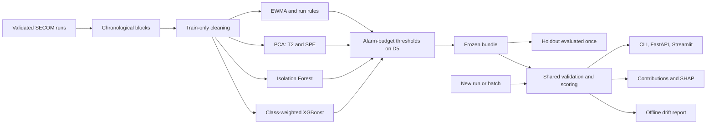

# 04. Technical design

Status: draft, planning v0.1, 11 October 2026. Nothing below is implemented yet.

## 1. Architecture



One package owns validation, cleaning, scoring, policy and explanation. CLI, API and dashboard are thin adapters over the same predictor. No database or persisted chart state.

## 2. Stack

| Component | Choice |
|---|---|
| Language | CPython 3.11 |
| Tables | numpy, pandas, pyarrow |
| SPC maths | numpy, scipy (F and chi-square limits) |
| Models | scikit-learn (PCA, Isolation Forest), XGBoost |
| Explanations | SHAP TreeExplainer; own MSPC contribution code |
| Serving | FastAPI, Pydantic, Uvicorn |
| Dashboard | Streamlit, Plotly |
| Tracking | Local MLflow, SQLite backend |
| Monitoring | Evidently (`evidently.legacy` API as pinned in TurbineGuard) |
| Quality | pytest, ruff |
| Packaging | joblib, JSON metadata, Docker |
| Automation | GitHub Actions |

T01 resolves and pins versions in `requirements.lock`; TurbineGuard's pins are the starting point, not an assumption.

## 3. Layout

```text
07_YieldGuard_Semiconductor_Fault_Detection/
  README.md, AGENTS.md, LICENSE, pyproject.toml, requirements.lock
  Dockerfile, .dockerignore, .gitignore, .github/workflows/ci.yml
  configs/default.yaml
  docs/00_START_HERE.md ... 10_SOURCES.md, MODEL_CARD.md
  tasks/plan.md, tasks/todo.md
  src/yieldguard/
    cli.py, config.py
    data.py, synthetic.py, splits.py, quality.py
    spc.py, mspc.py, anomaly.py, train.py
    policy.py, evaluate.py, explain.py
    artifacts.py, predict.py, monitoring.py
  api/main.py, api/schemas.py
  app/dashboard.py
  scripts/download_data.py, smoke_api.py, benchmark_runtime.py
  tests/ (plus tests/fixtures/ for small synthetic files)
  data/raw/secom/, data/processed/, models/<version>/, reports/
```

Only `docs/01`-`05` and `tasks/` exist after planning. Other folders are created by the tasks that need them.

## 4. Module contracts

| Module | Input | Output |
|---|---|---|
| data | Two raw files or a validated CSV | Typed ordered runs |
| synthetic | Size, fail rate, seed | Raw-format files plus the true faulty-sensor list |
| splits | Timestamps only | Block and holdout manifest |
| quality | Training runs | Fitted pruning lists, medians, scaling, group map |
| spc | Monitored sensors, Phase I parameters | EWMA values, limits, rule signals, per-run score |
| mspc | Scaled passing runs | PCA model, T-squared, SPE, limits, contributions |
| anomaly | Scaled passing runs | Isolation Forest score |
| train | Retained columns, labels, config | XGBoost candidates, fold scores, MLflow runs |
| policy | Calibration-block scores, budget | Frozen thresholds per detector and budget |
| evaluate | Frozen scores, labels | Metrics, intervals, target verdicts |
| explain | One run, bundle | Ranked sensors per method |
| predict | Validated runs, bundle | All scores and flags |
| monitoring | Reference and current sensor tables | Drift HTML and JSON summary |

## 5. SPC definitions

1. **EWMA:** `z_t = lambda * x_t + (1 - lambda) * z_(t-1)`, `z_0` = centre line, lambda = 0.2, L = 3, limits `mu0 +/- L * sigma0 * sqrt(lambda / (2 - lambda) * (1 - (1 - lambda)^(2t)))`. A missing value leaves `z` unchanged and is marked.
2. **Run rules on individuals (standardised):** one point beyond 3 sigma; 2 of 3 beyond 2 sigma on one side; 4 of 5 beyond 1 sigma on one side; 8 consecutive on one side of the centre line.
3. **Monitored sensors:** 10 sensors chosen on training runs only, among retained columns with training missingness <= 5%, by largest absolute rank-biserial separation between fail and pass. Screening about 400 columns against about 60 fails will select some by chance; Benjamini-Hochberg adjusted p-values are reported beside the selection.
4. **Univariate per-run scores:** maximum absolute standardised individual value over monitored sensors; maximum standardised EWMA distance over monitored sensors.
5. **PCA:** components up to 80% cumulative variance, capped at 50. `T2 = sum(t_a^2 / lambda_a)`. `SPE = sum(residual_j^2)`.
6. **Theoretical limits:** T-squared from the F distribution; SPE from the moment-matched scaled chi-square (`g = var / (2 * mean)`, `h = 2 * mean^2 / var`). Reported for reference; operating thresholds come from the alarm budget.
7. **Contributions:** SPE contribution of sensor j is its squared residual; T-squared uses the complete-decomposition contribution. Contributions smear across correlated sensors, which is stated wherever they are shown.

## 6. API contract

| Endpoint | Behaviour |
|---|---|
| GET `/health` | 200 when the process is alive |
| GET `/ready` | 200 only with a compatible bundle; otherwise 503 |
| GET `/model-info` | Versions, primary detector, alarm budget, thresholds, data scope, target outcomes |
| POST `/score` | One run. 200 result; 422 invalid; 413 oversized; 503 no bundle |
| POST `/spc` | Ordered batch of 1-200 runs. EWMA values, limits and rule signals for monitored sensors, starting from the centre line |

`/score` request: `run_id` (1-64 chars, echoed), optional `timestamp` (echoed, never a predictor), `sensors` (array of exactly 590 numbers or nulls, in raw-file order), `explain` (default false), `top_k` (1-20, default 5). Unknown fields are rejected. Body cap 256 KiB; `/spc` cap 2 MiB.

`/score` response: `run_id`, `scores` (`t2`, `spe`, `mspc_index`, `iforest_score`, `xgb_score`), `alarms` per detector, `primary_detector`, `alarm`, `alarm_budget_per_100`, `n_missing`, `quality_warnings`, `top_sensors` (null unless requested), bundle/policy/schema versions.

EWMA is stateful, so `/score` does not return it; `/spc` takes the history explicitly. No training, upload or retraining endpoint.

## 7. Bundle contract

`models/<version>/` contains:

1. `quality.joblib`: pruning lists, medians, scaling, group map.
2. `spc.json`: monitored sensors, centre lines, sigmas, lambda, L, rule set.
3. `mspc.joblib`: PCA model, eigenvalues, theoretical limits.
4. `iforest.joblib`, `xgb_model.json`.
5. `policy.json`: primary detector, thresholds per detector for budgets 2, 5, 10, score directions.
6. `feature_schema.json`: 590 raw names, retained order, schema version.
7. `metadata.json`: version, data/config/split hashes, dependency versions, seed, MLflow run ID, file hashes, development results, target outcomes.
8. `monitoring_reference.parquet`, `reference_manifest.json`.

Development uses `models/staging/` with a run manifest; `freeze` copies validated components into an immutable version directory. Only project-generated bundles are loaded, with checksum and schema verification.

## 8. Dashboard

`app/dashboard.py`, four views:

1. EWMA chart per monitored sensor with limits and rule markers.
2. T-squared and SPE over run order with theoretical and budget thresholds.
3. Flagged-run drill-down: MSPC contributions and SHAP side by side, with group members.
4. Alarm-budget table: alarms, false alarms and recall at 2, 5 and 10 per 100.

A plain-language "Start here" page (problem, method, frozen findings, glossary) is the landing page. Each view opens with a jargon-free summary and keeps method detail in a collapsed section.

It reads a bundle and a scored table through the shared package. Without SECOM present it runs on synthetic demo data and says so on screen. Labelled views show development data, and holdout data only after the final evaluation exists.

## 9. Runtime and monitoring

Logs carry request ID, timing, versions and error category, never full sensor vectors. Docker runs as a nonroot user and serves the API; the dashboard runs with a command override. Drift runs offline, as described in [the experiment plan](05_EXPERIMENT_PLAN.md), and never changes a bundle.

## 10. Conventions reused from TurbineGuard

Each sibling project is its own Git repository and package, so reuse is copy-and-adapt, not a shared import.

| Reuse | Source in `01_TurbineGuard_Predictive_Maintenance/` | Adaptation |
|---|---|---|
| Packaging, ruff, pytest flags | `pyproject.toml`, `requirements.lock` | Package `yieldguard`; add `streamlit` |
| Download with hashes and Zip Slip guard | `scripts/download_data.py` | UCI `secom.zip`; record licence and DOI |
| Typed YAML config | `src/turbineguard/config.py`, `configs/default.yaml` | New sections: `quality`, `spc`, `mspc`, `policy.alarm_budget` |
| Trusted bundle, staging then freeze | `src/turbineguard/artifacts.py` | Bundle members in section 7 |
| One-shot holdout evaluation | `src/turbineguard/evaluate.py` | Chronological holdout |
| Evidently drift plus controls | `src/turbineguard/monitoring.py` | Row unit is a run; minimum batch 100 runs; missing-rate table |
| FastAPI shape | `api/main.py`, `api/schemas.py` | `/score` and `/spc` |
| Docker and CI | `Dockerfile`, `.github/workflows/ci.yml`, `scripts/smoke_api.py` | Same two CI jobs |
| Synthetic fixtures | `tests/conftest.py` | Generator lives in the package |
| Streamlit location | `05_RetailMind.../app/dashboard.py` | `app/dashboard.py` |
