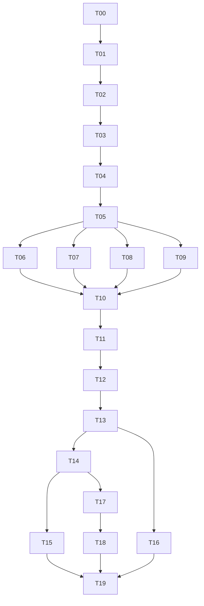

# YieldGuard implementation plan

Status: draft, planning v0.1, 11 October 2026. Implementation has not started.

## 1. Delivery approach

Build one trustworthy path first: raw files -> chronological blocks -> train-only cleaning -> metrics and alarm policy -> SPC baselines. Add ML detectors only after the SPC path and the evaluation code are tested. Then freeze, evaluate the holdout once, and add serving, dashboard and monitoring through the same predictor.

The [PRD](../docs/02_PRD.md) defines scope. [tasks/todo.md](todo.md) is the only task tracker.

## 2. Milestones

Estimates assume one developer on a CPU machine. No calendar dates are invented.

| Milestone | Tasks | Estimate | Exit evidence |
|---|---|---|---|
| M0 Planning files | T00 | 0.5 h | Seven Markdown files in the project folder |
| M1 Data foundation | T01-T04 | 11-15 h | Environment, provenance, frozen split, train-only cleaning, synthetic generator |
| M2 Evaluation and SPC baselines | T05-T07 | 11-15 h | Tested metrics/policy, EWMA and run rules, T-squared and SPE |
| M3 ML comparison and decision | T08-T10 | 9-13 h | Bounded comparison, primary detector, frozen thresholds |
| M4 Explanations and frozen evaluation | T11-T12 | 6-9 h | Sensor rankings, bundle, one holdout report |
| M5 Inference surfaces | T13-T15 | 10-14 h | CLI/API parity, dashboard |
| M6 Operations and handoff | T16-T19 | 10-13 h | Drift controls, Docker, CI, model card, README |
| Total | T00-T19 | 58-80 h | Local deliverable with an honest verdict |

## 3. Dependency order

## 4. Checkpoints

1. **C1 after T04:** split is timestamp-only and frozen; later blocks cannot change fitted cleaning; holdout labels unreadable by training code. Stop if any leak is open.
2. **C2 after T07:** SPC maths matches hand-computed fixtures; alarm thresholds reproduce the budget on calibration data.
3. **C3 after T10:** primary detector and thresholds recorded with development intervals. Config and protocol versions frozen. Holdout labels still unopened.
4. **C4 after T12:** one holdout record exists; every target has a verdict.
5. **C5 after T19:** every README number links to a report; limitations visible.

## 5. Risk register

| ID | Risk | Impact | Mitigation |
|---|---|---|---|
| R1 | About 26 holdout fails | Intervals too wide to separate detectors | State it up front; paired intervals; no ranking claims inside the noise |
| R2 | Fail rate or sensors drift over time | Thresholds miss the budget; training fails unlike holdout fails | Target O3 measures it; drift report; reported as a finding |
| R3 | Timestamp format, ties or disorder differ from expectation | Wrong order means a wrong split | T02 inspects and fixes the format; tie rule in the data spec |
| R4 | Cleaning or sensor selection fitted on all data | Leakage, inflated results | Fold-fitted transformers; perturbation tests |
| R5 | Holdout used more than once | Invalid generalisation claim | Sealed label file, one-shot command, overwrite refusal |
| R6 | Thresholds from only 235 calibration runs | Noisy alarm rate | Declared tolerance; uncertainty stated; no recalibration on holdout |
| R7 | EWMA finds few per-run fails | Looks like a failed project | Declared as an expected possible negative result; charts still delivered |
| R8 | Anonymous sensors, no ground truth for ranking | Ranking cannot be validated on SECOM | Synthetic ground-truth test; descriptive wording only |
| R9 | Contribution smearing and collinear groups | Misleading top sensor | Group map reported with every ranking; caveat shown |
| R10 | Single-stream assumption is wrong | Inflated variance, weak charts | Stated limitation; no tool-level claim |
| R11 | Licence terms change or mirror confusion | Redistribution problem | UCI only; licence text and date in manifest; raw data not committed by default |
| R12 | Synthetic CI data hides real-data bugs | False confidence | Same loader and file format; local integration tests on SECOM; claims only from real-data runs |
| R13 | Dependency incompatibility (SHAP/XGBoost/Evidently/Streamlit) | Broken explain, drift or dashboard | Pin in T01; additivity test; AppTest smoke |
| R14 | Docker unavailable locally | Container evidence missing | Gate marked unverified until CI or local run proves it |
| R15 | Scope growth (hosting, calibration, extra models) | Delay | PRD boundaries; backlog only |

## 6. Open questions

Defaults are used unless the user decides otherwise before the named task.

| ID | Question | Default | Needed by |
|---|---|---|---|
| Q1 | Is CC BY 4.0 with attribution acceptable for publishing trained weights and a small transformed reference table derived from SECOM? | Yes, with attribution in README, model card and sources | T12 |
| Q2 | Commit the raw data (permitted by CC BY 4.0) or download on demand? | Download on demand with pinned hashes | T02 |
| Q3 | Can CI run without the real download? | Yes: all required tests and the dashboard smoke test use the synthetic generator; real-data tests carry the `integration` marker and skip when data is absent | T02 |
| Q4 | Which bundle does the Docker smoke test load? | The committed real release bundle with a synthetic request, as in TurbineGuard | T17 |
| Q5 | Split of 60% fit / 15% calibration / 25% holdout? | As specified; a larger holdout would cut training fails below about 60 | T03 |
| Q6 | Primary alarm budget of 5 per 100 runs? | 5, with 2 and 10 reported | T05 |
| Q7 | Are targets O1-O3 the right level? | As drafted; they are the user's to change before T05, not after | T05 |
| Q8 | Should an SPC detector be primary when ML is not clearly better? | Yes (selection rule 4) | T10 |
| Q9 | New Git repository for this project, local only? | Yes, `git init` in T01, no remote or push without instruction | T01 |
| Q10 | Add a regularised logistic baseline? | No; backlog | - |

Dataset licence as verified on 11 October 2026: the UCI page states CC BY 4.0, DOI 10.24432/C54305, McCann & Johnston (2008). T02 records the licence text again at download time.

## 7. Definition of done and change control

A task is done when its acceptance check passes and the evidence is logged in `docs/09_PROGRESS_LOG.md`. A missed numerical target stays missed. Material changes go into `docs/08_DECISIONS_LOG.md` and the owning document before dependent code. Expansion stops when scoring, reports, API, dashboard, container, CI and drift evidence are complete.
